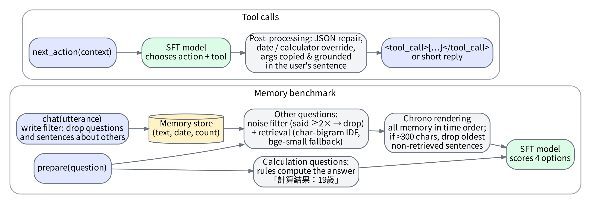

# MiniMind Memory Agent

A long-term memory agent built on a **64M-parameter** language model. The agent remembers what a user said across multiple chat sessions, answers questions about it, knows when it was never told something, and decides when to call tools (`memory_save`, `memory_search`, `calculator`, `get_date`).

The project explores a simple question: **how far can a very small model go if the memory system around it is designed well, and what does fine-tuning add on top?**

## Highlights

- **0.22 → 0.94 on unseen phrasings.** On a blind test set whose phrasings, values and attributes never appear in training, the agent scores 0.943 versus 0.217 for a keyword-retrieval baseline (score = 0.7 × memory accuracy + 0.3 × tool accuracy).
- **Let the model read, not the retriever guess.** Our first agent handed the model only the sentences a retriever picked; 82% of its errors were retrieval misses on paraphrases. Giving the fine-tuned model the whole memory in time order (trimmed to 300 characters) was the largest single gain.
- **Training aimed at the metric.** Answers are scored by option likelihood, so the reading objective ranks the correct option above the other three; tool-call SFT is trained in the same run (28 minutes on one GPU).
- **Honest evaluation.** Besides the validation set (now saturated), we wrote four disjoint template sets: two for training, one for development decisions, and one held out as a blind test until the final model was trained.
- **No forgetting.** Accuracy on a general Traditional-Chinese knowledge benchmark (TMMLU+) does not drop after fine-tuning.

## How it works



| Memory operation | Approach |
| --- | --- |
| **Write** | Keep the user's own statements with their session date; drop questions and sentences about other people (“my friend…”, “my coworker…”). |
| **Noise** | Small talk recurs across sessions while facts are stated once, so sentences said two or more times are ignored at read time (removes ~94% of small talk). |
| **Read** | Return the whole remaining memory in time order. When it exceeds 300 characters, the oldest sentences *not* picked by the retriever (character-bigram IDF + a 24M sentence-embedding fallback) are dropped first. |
| **Update** | Nothing is overwritten: the newer value always appears below the older one, and reading SFT teaches the model to prefer the later mention. |
| **Abstain** | No special marker: when no option appears in memory, the model chooses “you never mentioned it” (blind-test accuracy 1.00). |
| **Compute** | Six rules detect arithmetic questions (ages, annual rent, sibling count…), compute in code and pass only the result to the model. |
| **Tool calls** | The fine-tuned model decides whether and which tool to call. Post-processing repairs JSON, forces `get_date` / `calculator` for obvious cases, rebuilds expressions from the user's own numbers, copies values from the user's sentence, and grounds keys in the user's words. |

### Fine-tuning

One SFT run on the base model trains two skills:

- **Tool calling** (11,045 items): the prompt matches the agent's tool-call prompt exactly; the target is a `<tool_call>` block or a short reply. Half of the save items get a copy whose value is replaced by a random word, so the model learns to copy values instead of memorising them.
- **Reading memory** (20,000 items): contexts are produced by the agent itself, so training sees the same memory text as evaluation. Each option is scored by its average per-character log-likelihood (as in evaluation); the loss is cross-entropy over the four options plus 0.5 × the LM loss of the correct answer.

2 epochs, AdamW, lr 2e-5 with warm-up and linear decay, bf16.

## Results

| System | Validation | Blind test (unseen phrasings) |
| --- | --- | --- |
| Base model + no memory | 0.188 | 0.202 |
| Base model + recent context | 0.221 | 0.212 |
| Base model + keyword retrieval | 0.250 | 0.217 |
| First agent: retrieved sentences only, + SFT | 0.946 | 0.768 |
| **Final agent + SFT** | **0.999** | **0.943** |

Blind-test accuracy by question type (final agent): single fact 0.930, update 0.882, multi-fact 0.928, abstain 1.000, distractor 0.944, computation 1.000; tool-call end-to-end 0.933. The validation set shares templates with the training data and no longer separates systems; the blind test is the realistic estimate. (The blind test scored 0.909 before we fixed two rule gaps it revealed; numbers after that fix are no longer strictly blind.)

### Ablations (blind test, final model)

| Variant | Memory | Tool e2e | Score |
| --- | --- | --- | --- |
| **Final agent + SFT** | **0.947** | **0.933** | **0.943** |
| Same model, no memory | 0.229 | 0.800 | 0.400 |
| Same model, keyword retrieval | 0.404 | 0.800 | 0.523 |
| Final agent, **no SFT** | 0.386 | 0.190 | 0.327 |

Both parts matter: removing fine-tuning costs 0.62 points, replacing the memory framework with keyword retrieval costs 0.42. Development ablations showed that tool-only or reading-only SFT each teach one skill and mixing them loses nothing, and that the time-ordered memory layout beat two retriever-first layouts.

### General knowledge (TMMLU+, held-out split)

| Model | Micro accuracy (mean of original and option-shuffled order) |
| --- | --- |
| Base model | 25.6% |
| Fine-tuned agent model | 26.9% |

### Known weaknesses

- **Updates on unseen attributes:** on a car attribute never seen in training, the model often keeps the old value, so “prefer the later mention” was learned per attribute rather than in general.
- **300-character limit:** about half of the memories are trimmed; when the retriever misses an unseen attribute, its sentence can be dropped.
- **Keys for new attributes:** the model cannot name an attribute it never saw (e.g. blood type saved as “name”).

## Repository layout

| File | Purpose |
| --- | --- |
| `my_agent.py` | The memory agent (write / read / update / abstain / compute / tool calls) |
| `build_sft_data.py` | Builds SFT data in exactly the evaluation prompt format |
| `train_sft.py` | Tool-call + reading SFT |
| `make_extra_data.sh`, `templates/` | Four template sets: A and C for training, B for development, D as the blind test |
| `run.sh` | Reproduces the final model end to end |
| `post_eval.sh` | Ablations and the knowledge-benchmark check |
| `round2.sh`, `round3.sh`, `round3b.sh`, `run_ablations.sh` | Experiment scripts from development |
| `my_agent_v1.py`, `my_agent_v2.py` | Earlier agents (retrieved-sentences-only) |
| `proxy_eval.py`, `tune.py` | Model-free retrieval check and parameter search |
| `logs/`, `results/` | Training and evaluation logs, result summaries |

## Models

| Role | Model | Parameters |
| --- | --- | --- |
| Language model | MiniMind-3 (Qwen3 architecture), fine-tuned | 63.9M |
| Sentence embedder | BAAI/bge-small-zh-v1.5 (frozen) | 24.0M |

## Reproducing

The evaluation harness and dataset generator are not included in this repository; `run.sh` expects them, the data and the embedder next to it.

```bash
pip install torch transformers
hf download BAAI/bge-small-zh-v1.5 --local-dir embedder
bash run.sh            # downloads MiniMind-3, builds SFT data, trains (~28 min), evaluates
```

Tested on a single NVIDIA GeForce RTX 4070 Ti SUPER (16 GB) under WSL2; retraining in a fresh environment gives scores within 1–2 points of the reported model.
