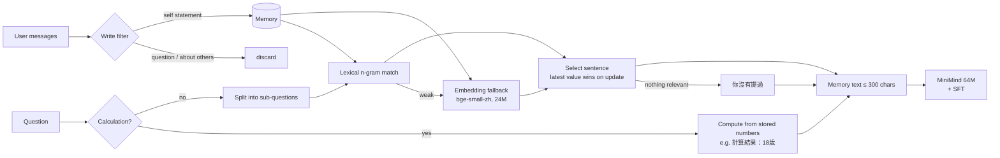

# MiniMind Memory Agent

A long-term memory agent built on a **64M-parameter** language model. The agent remembers what a user said across multiple chat sessions, answers questions about it, knows when it was never told something, and decides when to call tools (`memory_save`, `memory_search`, `calculator`, `get_date`).

The project explores a simple question: **how far can a very small model go if the memory system around it is designed well, and what does fine-tuning add on top?**

> **Status:** work in progress. Results below are preliminary; ablations are still running.

## Highlights

- **Framework first.** A rule-based memory pipeline with no training lifts memory accuracy from 0.33 to 0.50 over a keyword-retrieval baseline.
- **Small model, small embedder.** Retrieval combines character n-gram matching with a 24M-parameter sentence embedder that only steps in when lexical matching fails, which keeps precision on familiar phrasings and recovers paraphrases.
- **Training aimed at the metric.** Multiple-choice answers are scored by option likelihood, so the reading objective trains the model to rank the correct option above the other three, together with tool-call SFT in one run (8 minutes on a single GPU).
- **Honest evaluation.** Besides the validation set, a separate *pseudo-test set* with unseen phrasings, values and attributes estimates how the agent generalizes.

## How it works



| Memory operation | Approach |
| --- | --- |
| **Write** | Keep the user's own statements; drop questions and sentences about other people (“my friend…”, “my coworker…”). |
| **Noise** | A sentence repeated in a user's history is treated as small talk: facts are stated once, chit-chat repeats. |
| **Read** | Split multi-part questions; score each part with weighted character bigrams, and fall back to embedding similarity only when lexical evidence is weak and one sentence clearly stands out. |
| **Update** | If a later related sentence carries update cues (changed, moved, now…), only the newest value is placed in memory, so the stale value is never shown to the model. |
| **Abstain** | When nothing relevant is found, the memory says so explicitly (“you never mentioned it”). |
| **Compute** | Arithmetic questions are detected and solved in code; only the result is placed in memory. |
| **Tool calls** | Generated by the fine-tuned model. A light repair step only fixes malformed JSON and never changes which tool is chosen. |

### Fine-tuning

One SFT run trains two skills from the same base model:

- **Tool calling:** the prompt matches the agent's tool-call prompt exactly (system message plus tool schema in the chat template); the target is a `<tool_call>` block, or a short reply when no tool should be used.
- **Reading memory:** contexts come from the agent's own retrieval, so training sees the same memory text as evaluation. For each question, the average per-character log-likelihood of each option is computed, a softmax is taken over the four options, and cross-entropy is applied on the correct one, plus a small LM loss on the correct answer.

Training data combines the public training split with additional template-generated data (new phrasings, values and attributes). A second, disjoint template set is reserved for the pseudo-test set and never used for training or tuning.

## Results (preliminary)

Leaderboard score = 0.7 × memory accuracy + 0.3 × tool end-to-end accuracy.

| Setup | Memory (val) | Tool e2e (val) | **Score (val)** | **Score (pseudo-test)** |
| --- | --- | --- | --- | --- |
| Keyword retrieval baseline | 0.333 | 0.055 | 0.250 | TBD |
| Memory framework, no SFT | 0.496 | 0.055 | 0.364 | TBD |
| **Memory framework + SFT** | **0.923** | **1.000** | **0.946** | **0.757** |

The validation set shares phrasing templates with the training data, so validation scores are optimistic. The pseudo-test set uses phrasings and attributes the model never saw and is the more realistic estimate.

Ablations (SFT components, data diversity, framework vs. training) and a check for regression on a general knowledge benchmark are in progress.

## Repository layout

| File | Purpose |
| --- | --- |
| `my_agent.py` | The memory agent (write / read / update / abstain / compute / tool calls) |
| `build_sft_data.py` | Builds SFT data in exactly the evaluation prompt format |
| `train_sft.py` | Tool-call + reading SFT |
| `make_extra_data.sh`, `templates/` | Extra template sets: A for training, B for the pseudo-test set only |
| `proxy_eval.py`, `tune.py` | Model-free retrieval check and parameter search used during development |
| `run_ablations.sh` | Ablation and regression experiments |
| `logs/`, `results/` | Training and evaluation logs, result summaries |

## Models

| Role | Model | Parameters |
| --- | --- | --- |
| Language model | MiniMind (Qwen3 architecture) | 63.9M |
| Sentence embedder | BAAI/bge-small-zh-v1.5 | 24.0M |

## Reproducing

The evaluation harness and dataset generator are not included in this repository.

```bash
conda create -n minigpt -c conda-forge --override-channels python=3.11 -y
conda activate minigpt
pip install torch==2.14.0 transformers==4.57.6 datasets
hf download BAAI/bge-small-zh-v1.5 --local-dir models/bge-small-zh-v1.5

bash make_extra_data.sh                       # extra training data and pseudo-test set
python build_sft_data.py --model_dir <base-model> --out data/sft/sft.jsonl
python train_sft.py --base_model <base-model> --data data/sft/sft.jsonl --out_dir models/sft_v1
```

Tested on a single NVIDIA GeForce RTX 4070 Ti SUPER (16 GB) under WSL2.
